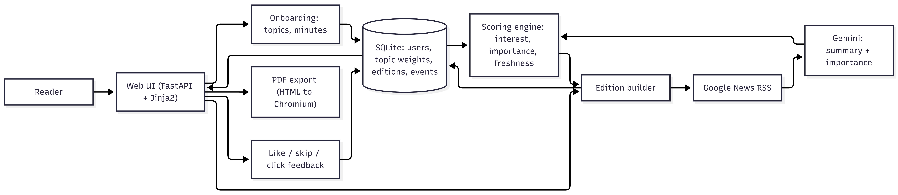

# Personal Morning Paper


A personalized daily newspaper that learns what each reader cares about.

## What it does
- **Onboarding:** reader picks topics, optional keywords, and reading time
- **Daily paper:** articles from Google News RSS, summarized by Gemini, ranked by a deterministic scoring engine
- **Web page + PDF:** the same edition as a web page and a newspaper-style PDF
- **Archive:** previous editions are stored and can be reopened
- **Learning:** "More like this", "Not interested", and article clicks update interest weights; skipped stories never return; liking a new topic adds it to the profile
- **Exploration:** a couple of stories outside the reader's usual topics in every edition

## Architecture


## How personalization works
Score = 0.5 x topic interest + 0.3 x story importance + 0.2 x freshness. The AI only summarizes and rates importance. Ranking and learning are plain, tested Python.

## Run locally
```
python -m venv venv
venv\Scripts\activate
pip install -r requirements.txt
playwright install chromium
set GEMINI_API_KEY=your-key
uvicorn main:app --reload
```

## Stack
FastAPI, Jinja2, SQLite, Gemini, Google News RSS, Playwright (PDF)